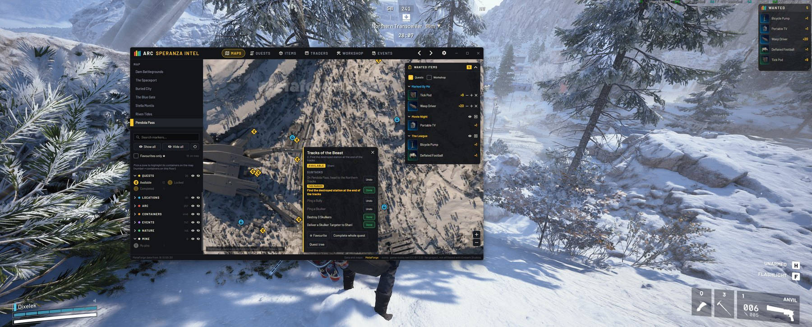
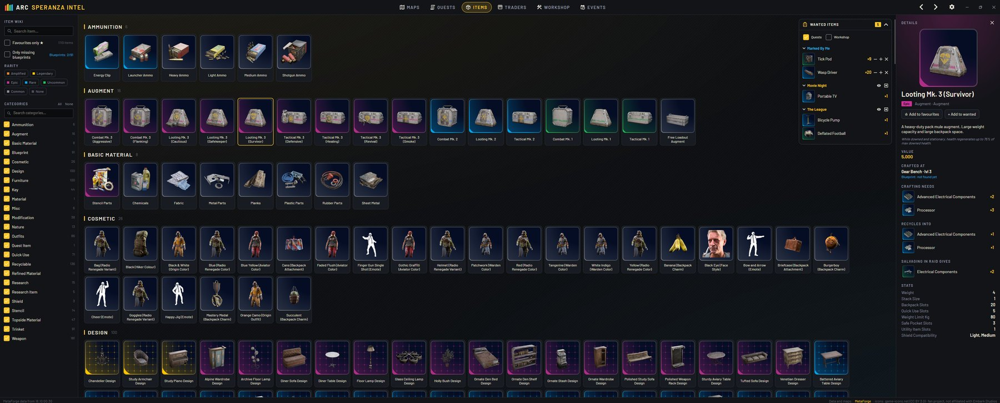
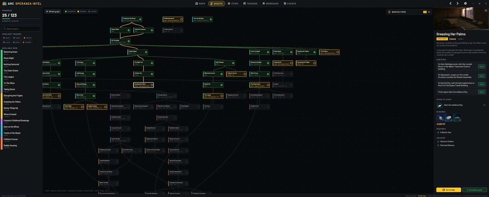
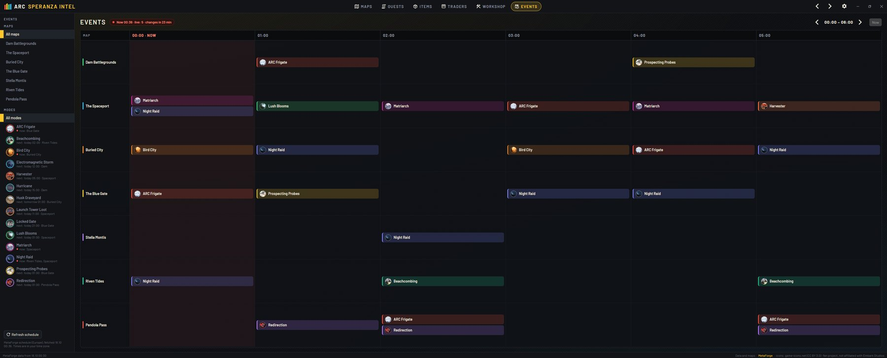
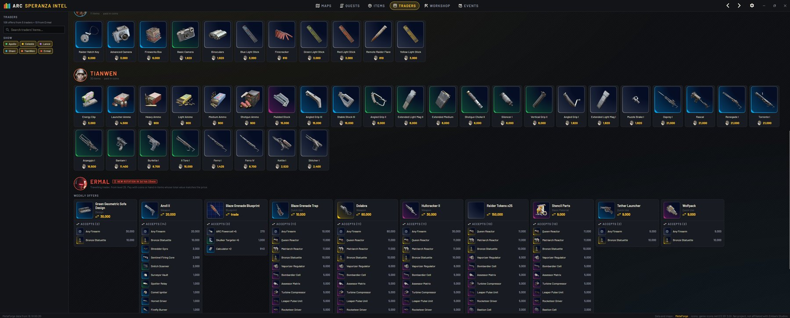
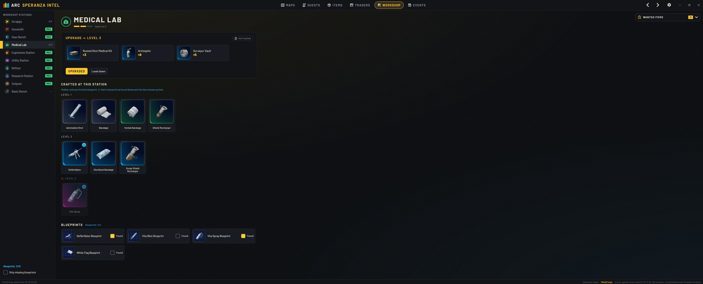

# ARC Speranza Intel



A free, unofficial desktop companion for **ARC Raiders** (Windows): interactive maps with markers and floors, the full quest tree with subtasks, an item wiki, traders (including Ermal's weekly offers) and the live event schedule. UI in English, Polish, German, French, Spanish, Portuguese (Brazil), Russian, Japanese and Simplified Chinese.

Darmowy, nieoficjalny towarzysz do **ARC Raiders** (Windows): mapy z markerami i piętrami, drzewko questów z subtaskami, wiki itemów, handlarze (z tygodniowymi ofertami Ermala) i harmonogram wydarzeń. Interfejs w 9 językach: angielski, polski, niemiecki, francuski, hiszpański, portugalski (BR), rosyjski, japoński i chiński uproszczony.

> Fan project, not affiliated with Embark Studios. ARC Raiders and its names and artwork belong to Embark Studios.
> The app does **not** read game memory or files, inject anything or simulate input.

## Download / Pobieranie

Grab `ArcSperanzaIntel-win-Setup.exe` from [Releases](../../releases). It installs per-user (no admin) and updates itself.
Pobierz `ArcSperanzaIntel-win-Setup.exe` z [Releases](../../releases). Instaluje się bez uprawnień administratora i sam się aktualizuje.

> **Windows SmartScreen:** the installer isn't code-signed yet, so Windows may show "Windows protected your PC". Click **More info → Run anyway**. The full source code is here on GitHub.
> Instalator nie jest jeszcze podpisany cyfrowo, więc Windows może pokazać „System Windows ochronił komputer”. Kliknij **Więcej informacji → Uruchom mimo to**. Cały kod źródłowy jest tutaj na GitHubie.

## Features

- **Maps** — all 7 maps (MetaForge tiles), floors (Stella Montis, Spaceport tunnels, Blue Gate underground), category filters, favourites, your own pins with notes, quest markers coloured by quest state; loot zones (Industrial, Medical, Residential…) highlight matching containers.
- **Quests** — one big graph; click a quest for subtasks, required items and rewards, "go to map"; completing all subtasks completes the quest.
- **Wanted items** — a collapsible panel grouped by quest, plus your own "Marked By Me" list.
- **Items** — wiki of every item by category with search and filters; which loot zones to search (click to see them on the map); crafting ingredients, what it recycles / salvages into, what it is recycled from, weapon upgrades.
- **Workshop** — station levels, what the next level needs (goes to Wanted), crafts per level, weapon upgrade chains, blueprints you have found.
- **Overlay** — a small always-on-top window with your wanted items over the game (Ctrl+Shift+O, borderless mode). It starts locked so the mouse ignores it and no cursor shows over it (handy with two monitors); Ctrl+Shift+L unlocks it to move or resize. Plain window: it does not read the game or the screen.
- **Traders** — every trader's stock with prices (coins, or seeds for Celeste) and Ermal's weekly rotation with accepted items and their values.
- **Events** — what's live now and what's coming, per map; event region (Europe, North America, Oceania) picked automatically from your time zone or set in Settings.
- **Settings** — editable shortcuts, global hotkeys (Ctrl+F window, Ctrl+Shift+O overlay, Ctrl+Shift+L overlay lock), overlay opacity, always-on-top, language, event region, updates, reset.

## Screenshots

**Items** – every item as a game-style tile, details with crafting, recycling and where to look, plus your wanted list.


**Quests** – the whole quest tree with your progress, subtasks, rewards and what each quest unlocks.


**Events** – what's live now and in the next hours on every map, for your server region.


**Traders** – all traders' stock with prices and Ermal's weekly trades with the items he accepts.


**Workshop** – station levels, what the next upgrade needs, crafts per level and blueprints you've found.


## Feedback

Found a bug or have an idea? Use **Settings → Feedback** in the app — it opens a ready GitHub issue with the app version and recent errors (your Windows user name is removed). Or open one directly:
[Report a bug](../../issues/new?template=bug.yml) · [Suggest a feature](../../issues/new?template=feature.yml) · [Translation mistake](../../issues/new?template=translation.yml)

No GitHub account? In the app click **Copy diagnostic info** and send it to the author.

## Translations

The interface is available in 9 languages; it picks your Windows language on first start and can be changed in Settings. Item, quest and map names come from MetaForge and stay in English. Translations other than Polish and English are new — if something reads wrong, please open an issue. Texts live in `tools/i18n/<language>.json`; run `python tools/i18n_gen.py` to regenerate the C# files.

## Build from source

Requires the .NET 9 SDK (or newer).

```
dotnet run --project src/ArcSperanzaIntel.App
dotnet test
```

Installer locally: `release.bat 1.0.0` (Velopack, output in `releases/`).
New public release: push a tag `v1.2.0` — the GitHub Actions workflow builds `Setup.exe` and publishes it; installed apps pick it up automatically.

## Structure

```
src/ArcSperanzaIntel.Core      logic without UI (API, parser, quest book, maps, localization)
src/ArcSperanzaIntel.App       Avalonia 11 UI, MVVM (CommunityToolkit.Mvvm)
tests/ArcSperanzaIntel.Tests   xUnit
```

UI texts live in `src/ArcSperanzaIntel.Core/Localization/Texts.cs` (key → Polish, English).

## Author

Made by **Filip Bujak** ([@filipbujak](https://github.com/filipbujak)).

## Data and credits

- Game data, map tiles, item icons and the event schedule: [MetaForge](https://metaforge.app/arc-raiders) — community data, cached locally (12 h, events 30 min).
- Marker icons: [game-icons.net](https://game-icons.net) (CC BY 3.0) · UI icons: Material Design Icons (Apache 2.0) · Font: Barlow (OFL).

## Local data

- Progress and settings: `%APPDATA%\ArcSperanzaIntel\state.json`
- Cache: `%LOCALAPPDATA%\ArcSperanzaIntel\cache`
- Crash log: `%APPDATA%\ArcSperanzaIntel\crash.log`

## When a map stops loading after a game patch

MetaForge changes the version in the tile URL (e.g. `20260112-q85`). Update it in `src/ArcSperanzaIntel.Core/Maps/MapCatalog.cs`.
